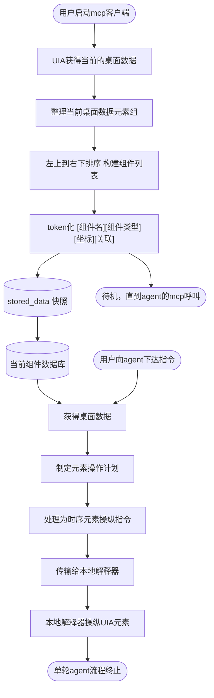

FLOW-TASK: build-software/desktop-python
FLOW-TARGET: OpenAgentCU · Windows 桌面智能体桥 | source: open_agent_computer_use_in_windows.ngm | stack: Python 3.10+ 标准库 / PowerShell 5.1 UIA / SQLite / JSON-RPC | entry: S1 | end: S14
FLOW-RULE: 顺序执行 S1→S15；每步验收通过后勾选 STATUS；判断按实测分支；失败按 §5 处理；范围外变更先问

# OpenAgentCU · 构建逻辑

> 来源: `open_agent_computer_use_in_windows.ngm` ｜ 节点: 15 ｜ 边: 14 ｜ 生成: 2026-11-06

## 0. 任务卡

- **构建什么**: 一个 Windows 本机的“桌面感知 + 元素操作”桥。它先用 UI Automation 抓取桌面控件树，整理、排序、token 化成 `[组件名][组件类型][坐标][关联]` 组件库；用户或 agent 下达自然语言指令后，它把指令编译成带时序的解释器指令（IR），交给本地解释器按序操纵 UIA 元素。
- **成功标志**: `oacu scan` 能抓取当前桌面并落库；`oacu act "点击 <可见文字>"` 能定位到具体组件、生成 IR 并实际点击成功；`oacu mcp serve` 可作为 MCP 服务被客户端调用；全程有 CLI 可观测、可回放。
- **非目标**: 不做视觉截图识别/OCR、不做多轮自主规划、不做跨机远程控制、不做浏览器 DOM 注入、不内置任何 LLM 调用。
- **运行环境**: Windows 10/11 x64；Python 3.10+；PowerShell 5.1（提供 `System.Windows.Automation`）；SQLite（标准库 `sqlite3`）。
- **外部依赖**: 无第三方 Python 包。UIA 走 PowerShell 桥；不可用时 `oacu doctor` 明确报错。

## 1. 执行契约

- 按 S 编号顺序施工；S5 的两条出边按“保存快照 / 进入待机”分别处理，不合并验收。
- 每步完成后运行 `- 验收:`，通过才把 §8 的 `[ ]` 改成 `[x]`。
- 只做当前步骤范围内的文件修改；不顺手重构其它模块。
- 所有对桌面的真实操作必须先经 `plan` 生成 IR，再经 `exec` 执行；`--dry-run` 不得触达鼠标键盘。
- 单轮执行失败不自动重试；把错误写进 `actions.status` 并走 S14。
- 遇到逻辑 MD 与实际环境冲突，停止并写 §9，不自行扩大范围。
- CLI 是唯一入口：任何能力都必须先有子命令，再接 MCP。

## 2. 节点清单

| 节点ID | 功能头 | 原文标签 | 类型 | 入度 | 出度 | 软件落点 | 备注 |
| --- | --- | --- | --- | --- | --- | --- | --- |
| N1 | START | 用户启动mcp客户端 | start | 0 | 1 | `oacu/cli.py`、`oacu/mcp/server.py` | 源 `Tz8nT_suwsh0rPDCcqxc-0` |
| N2 |  | UIA获得当前的桌面数据 | process | 1 | 1 | `oacu/uia/collector.py`、`oacu/uia/backend.py` | 源 `...-1`；PowerShell UIA 桥 |
| N3 |  | 整理当前桌面数据元素组 | process | 1 | 1 | `oacu/uia/normalize.py` | 源 `...-3` |
| N4 | LINEAR | 左上到右下来排序所有的组件 构建组件列表 | process | 1 | 1 | `oacu/uia/order.py` | 源 `...-8`；按行带 + x 排序 |
| N5 | DATA | 将桌面元素组token化 {[组件名][组件类型][坐标][关联]} | process | 1 | 2 | `oacu/tokens.py` | 源 `...-6`；六边形，两条出边 |
| N6 | DB,STORGE | （stored_data 图形，图中无文字） | database | 1 | 1 | `oacu/store.py` | 源 `rdFW...-8`；由形状与入边判定为存储 |
| N7 | DB | 当前组件数据库 | database | 1 | 1 | `oacu/store.py`、`oacu/context.py` | 源 `Tz8nT...-12`；查询视图 |
| N8 | START,INPUT | 用户向agent下达指令 | start | 0 | 1 | `oacu/cli.py`、`oacu/agent.py` | 源 `rdFW...-0`；第二条流程入口 |
| N9 |  | 获得 桌面数据 | process | 2 | 1 | `oacu/context.py` | 源 `rdFW...-3`；读库或重扫 |
| N10 |  | 制定元素操作计划 | process | 1 | 1 | `oacu/planner.py` | 源 `rdFW...-6` |
| N11 |  | 处理为解释器理解的时序元素操纵指令 | process | 1 | 1 | `oacu/ir.py` | 源 `rdFW...-10` |
| N12 | TRANSMUTE | 传输给本地解释器 | process | 1 | 1 | `oacu/transport.py` | 源 `rdFW...-14`；TCP 127.0.0.1:8765 |
| N13 |  | 本地解释器按照时序指令来操纵UIA元素 | process | 1 | 1 | `oacu/interpreter.py` | 源 `rdFW...-16`；“时许”按原文保留 |
| N14 | END | 单轮agent流程终止 | end | 1 | 0 | `oacu/agent.py` | 源 `rdFW...-18` |
| N15 | END | 待机，直到agent的mcp呼叫 | end | 1 | 0 | `oacu/mcp/server.py`、`oacu/mcp/protocol.py` | 源 `rdFW...-20`；进程级阻塞 |

## 3. 边清单

| From | To | 条件/标签（原文） | 边类型 |
| --- | --- | --- | --- |
| N1 | N2 |  | normal |
| N2 | N3 |  | normal |
| N3 | N4 |  | normal |
| N4 | N5 |  | normal |
| N5 | N6 | 保存 token 快照（图内无标签） | normal |
| N5 | N15 |  | normal |
| N6 | N7 | 浮空边还原：stored_data → 当前组件数据库 | normal |
| N7 | N9 |  | normal |
| N8 | N9 |  | normal |
| N9 | N10 |  | normal |
| N10 | N11 |  | normal |
| N11 | N12 |  | normal |
| N12 | N13 |  | normal |
| N13 | N14 |  | normal |

## 4. 构建步骤

### S1 {START}{PREPARE} · CLI 骨架与 MCP 客户端启动入口
- 节点: N1 (start)
- 目标: 先立起可执行、可自检的 CLI 骨架，所有能力都以子命令暴露；`oacu mcp serve` 就是“用户启动 mcp 客户端”的落点
- 落点: `pyproject.toml`、`oacu/__init__.py`、`oacu/__main__.py`、`oacu/cli.py`、`oacu/config.py`
- 动作: 建包与 `python -m oacu` 入口；argparse 子命令 `scan/dump/plan/act/exec/serve/mcp/doctor`；全局参数 `--json/--db/--backend/--timeout/--verbose`；退出码约定 0 成功、1 运行失败、2 用法错误、3 环境/数据不可用；配置默认路径 `%APPDATA%/OpenAgentCU/`，可用 `--db` 覆盖
- 输入: 命令行参数、可选 `config.json`
- 产出: `python -m oacu --help`、`python -m oacu --version`、统一 `die(code, msg)` 与 JSON 输出器
- 验收: `python -m oacu --version` 退出码 0 并打印版本；`python -m oacu --help` 列出 8 个子命令；`python -m oacu nope` 退出码 2
- 下一步: S2

### S2 · UIA 获得当前的桌面数据
- 节点: N2 (process)
- 目标: 用 Windows UI Automation 抓取当前桌面的顶层窗口与控件树，输出可序列化的原始元素
- 落点: `oacu/uia/backend.py`、`oacu/uia/collector.py`、`tools/uia_dump.ps1`
- 动作: 默认后端 `ps`：调用 PowerShell 5.1 加载 `UIAutomationClient`/`UIAutomationTypes`，用 `ControlViewWalker` 递归遍历，把 name/control_type/automation_id/class_name/rect/parent_index/depth/is_enabled/is_offscreen 以 UTF-8 JSON 写到临时文件；限制 `--max-depth`（默认 12）与 `--max-elements`（默认 3000）；若 `pywinauto` 可导入则允许 `--backend uia`；后端不可用时报错而不是返回空
- 输入: 当前桌面、深度/数量上限、可选窗口标题过滤
- 产出: `list[RawElement]`，每个元素含 `name, control_type, rect, automation_id, class_name, parent, depth, enabled, offscreen`
- 验收: `python -m oacu doctor --json` 输出 `{"ps_uia": true, ...}`；`python -m oacu scan --raw --json` 在桌面至少返回 1 个窗口和 1 个子控件
- 失败: PowerShell 不可用或 UIA 加载失败 → 退出码 3，提示检查 `powershell -NoProfile`
- 下一步: S3

### S3 · 整理当前桌面数据元素组
- 节点: N3 (process)
- 目标: 把原始树整理成稳定、可比较的元素组，去掉噪声
- 落点: `oacu/uia/normalize.py`
- 动作: 丢弃宽或高 ≤ 0 的元素；丢弃 `name` 与 `automation_id` 同时为空且无子节点的纯容器；按 `(name, control_type, rect, automation_id)` 去重；保留父子索引与顶层窗口归属；输出 `dropped` 统计
- 输入: `list[RawElement]`
- 产出: `list[Element]`（字段固定，顺序为遍历顺序）、`NormalizeStats(raw, kept, dropped)`
- 验收: `python -m unittest tests.test_normalize -v` 覆盖零面积、重复、空容器、正常控件 4 类样例；`scan --json` 的 `stats.dropped` 与样例一致
- 下一步: S4

### S4 {LINEAR} · 左上到右下排序并构建组件列表
- 节点: N4 (process)
- 目标: 用视觉阅读顺序线性化元素，给后续 token 稳定编号
- 落点: `oacu/uia/order.py`
- 动作: 同一窗口内按 `row_band = round(center_y / 20)` 分带；带内按 `center_x` 升序；带间按 `row_band` 升序；跨越窗口时按窗口 z-order 优先；输出 `order` 从 1 开始
- 输入: `list[Element]`
- 产出: `list[OrderedElement]`（含 `order`、`window`、`row_band`）
- 验收: `python -m unittest tests.test_order -v`：两行三列样例得到 1..6；同一行上下抖动 ±9px 不乱序；负坐标窗口仍按左上优先
- 下一步: S5

### S5 {DATA} · 将桌面元素组 token 化 {[组件名][组件类型][坐标][关联]}
- 节点: N5 (process)
- 目标: 生成压缩、可读、可回指的 token 文本与结构化快照，作为组件库的唯一数据契约
- 落点: `oacu/tokens.py`
- 动作: 每个元素一行 `{[名称][类型][x,y,w,h][parent=..;window=..;id=..;order=..]}`；名称去换行并截断 40 字符，空名称回退为类型名；token id 用 `t0001` 递增；同时产出 `Snapshot` JSON（含窗口、分辨率、生成时间）
- 输入: `list[OrderedElement]`
- 产出: `Snapshot(snapshot_key, window, tokens=[Token...], text, stats)`；`Token(id, name, ctype, rect, relations, order)`
- 验收: `python -m unittest tests.test_tokens -v`：四个括号字段齐全、转义正确；同一输入两次 token 化字节级一致；`text` 行数等于 token 数
- 下一步: S6
- 待机分支 → S15

### S6 {DB}{STORGE} · 持久化 token 快照
- 节点: N6 (database)
- 目标: 每次扫描写入一份快照，供计划、回指、回放使用
- 落点: `oacu/store.py`
- 动作: 建库 `%APPDATA%/OpenAgentCU/oacu.db`；表 `snapshots(id INTEGER PRIMARY KEY, created_at TEXT, window TEXT, screen TEXT, token_count INT, text TEXT)`、`tokens(snapshot_id INT, token_id TEXT, name TEXT, ctype TEXT, x INT, y INT, w INT, h INT, relations TEXT, ord INT, PRIMARY KEY(snapshot_id, token_id))`、`actions(id INTEGER PRIMARY KEY, trace_id TEXT, snapshot_id INT, instruction TEXT, plan TEXT, ir TEXT, status TEXT, error TEXT, created_at TEXT)`；单事务写入；同一窗口只保留最近 20 份快照
- 输入: `Snapshot`
- 产出: `oacu.db`、`snapshot_id`
- 验收: `python -m unittest tests.test_store -v`：写入后按 id 能查回全部 token；重复写入同 key 不报错；裁剪后旧快照不可查
- 失败: 磁盘不可写 → 退出码 3，打印库路径
- 下一步: S7

### S7 {DB} · 当前组件数据库（查询层）
- 节点: N7 (database)
- 目标: 提供“当前组件”的统一读取接口，让命令流程不必重复抓桌面
- 落点: `oacu/store.py`、`oacu/context.py`
- 动作: `latest_snapshot(window=None)`、`get_tokens(snapshot_id)`、`resolve(snapshot_id, token_id)`、`is_stale(snapshot_id, max_age_s=30)`；`dump` 子命令按 `--limit` 输出最近快照的 token 文本与 JSON
- 输入: 窗口过滤、快照 id
- 产出: `SnapshotRecord` 与 `Token` 列表；空库时抛 `NoSnapshot`
- 验收: `python -m oacu dump --json` 返回 `snapshot_id/created_at/window/tokens[]`；空库时退出码 3 且提示“先执行 oacu scan”
- 下一步: S8

### S8 {START}{INPUT} · 用户向 agent 下达指令
- 节点: N8 (start)
- 目标: 接收一条自然语言指令，开启单轮执行，并留下可追溯记录
- 落点: `oacu/cli.py`、`oacu/agent.py`
- 动作: `python -m oacu act "<指令>"`；支持 `--instruction-file`、`--dry-run`、`--window`；生成 `trace_id`（时间戳 + 6 位随机）；先写 `actions(status=pending)`；空指令或超长（>2000 字）拒绝
- 输入: 指令文本、可选窗口
- 产出: `ActionRequest(trace_id, instruction, window, dry_run)`
- 验收: `python -m oacu act "点击记事本" --dry-run --json` 返回 `trace_id` 且 `dry_run=true`；空指令退出码 2；`actions` 能查到该 trace_id
- 下一步: S9

### S9 · 获得桌面数据
- 节点: N9 (process)
- 目标: 为本次指令取得最新组件快照；过期或无快照时自动重扫
- 落点: `oacu/context.py`
- 动作: 读 `latest_snapshot(window)`；若不存在或 `age_s > max_age_s`（默认 30）或窗口不存在，则调用 S2→S5 重扫并写库；返回 `Context(snapshot_id, age_s, tokens, refreshed)`
- 输入: `trace_id`、窗口过滤
- 产出: `Context`
- 验收: `python -m unittest tests.test_context -v`：无快照时会触发一次 collector（用计数器断言）；新鲜快照时 `refreshed=false` 且 collector 调用次数为 0
- 失败: 重扫仍为空（锁屏/独占全屏）→ 返回 `empty_desktop`，走 S14
- 下一步: S10

### S10 · 制定元素操作计划
- 节点: N10 (process)
- 目标: 把自然语言指令映射为对具体 token 的动作序列，不执行任何操作
- 落点: `oacu/planner.py`
- 动作: 按“然后/再/，/;”切分子句；每句解析动词（点击/双击/右键/输入/选择/滚动/按键/激活）；目标短语匹配 token，优先级 exact > 包含 > difflib `SequenceMatcher.ratio() ≥ 0.6`；同分时取 `order` 更小者；输出 `Plan(steps=[{op, token_id, value?, times?}])`；未命中时返回候选 top5
- 输入: 指令、`Context.tokens`
- 产出: `Plan`，含每个子句的 `raw`、`op`、`token_id`、`score`、`candidates`
- 验收: `python -m unittest tests.test_planner -v`：点击/输入/双击/滚动/按键/未命中 6 条样例全部命中预期 token；未命中时 `candidates` 非空且按分数降序
- 失败: 任一句无法匹配 → 不执行，返回 `no_match`，走 S14，退出码 1
- 下一步: S11

### S11 · 处理为解释器理解的时序元素操纵指令
- 节点: N11 (process)
- 目标: 把计划编译成带时间偏移、可校验、可回放的中立 IR
- 落点: `oacu/ir.py`
- 动作: IR v1：`{version:"1.0", trace_id, snapshot_id, created_at, steps:[{op, token?, x?, y?, value?, keys?, ms?, at}]}`；`at` 为相对毫秒，默认步间隔 120；op 白名单 `invoke|set_value|click|double_click|right_click|scroll|key|wait|activate`；逐项校验必填参数（`invoke/set_value` 必须有 token，`click` 必须有 token 或坐标）；写 `%APPDATA%/OpenAgentCU/ir/<trace_id>.json`
- 输入: `Plan`
- 产出: IR 对象与 IR 文件路径
- 验收: `python -m unittest tests.test_ir -v`：合法 IR 通过；未知 op、缺 token 的 invoke、负 `at`、空 steps 均被拒并给出字段名
- 下一步: S12

### S12 {TRANSMUTE} · 传输给本地解释器
- 节点: N12 (process)
- 目标: 把 IR 送到本机解释器执行；没有守护进程时允许进程内回退
- 落点: `oacu/transport.py`、`oacu/cli.py`（`serve` 子命令）
- 动作: `oacu serve` 监听 `127.0.0.1:8765`，一行一条 JSON；请求 `{"type":"execute","ir":{...}}`，响应 `{"ok":bool,"results":[...],"error":str?}`；连接超时 0.5s、执行超时 10s；连接被拒且显式 `--inproc` 时直接调用 `interpreter.execute`；任何模式都记录 `actions.ir`
- 输入: IR
- 产出: 执行结果 JSON
- 验收: 终端 A `python -m oacu serve`，终端 B `python -m oacu exec <ir.json>` 收到 `ok=true`；未启动 serve 时 `--inproc` 也能跑通；`--json` 输出字段完整
- 失败: 连接被拒且未给 `--inproc` → 提示“先运行 oacu serve”，走 S14，退出码 1
- 下一步: S13

### S13 · 本地解释器按时序指令操纵 UIA 元素
- 节点: N13 (process)
- 目标: 严格按 `at` 调度并执行每个操作，逐步回报结果
- 落点: `oacu/interpreter.py`、`tools/uia_act.ps1`
- 动作: 按 `at` 稳定排序后顺序执行，用 `time.perf_counter()` 对齐；`invoke/set_value/scroll/activate` 走 PowerShell UIA 模式（`InvokePattern`/`ValuePattern`/`ScrollPattern`/`SetFocus`）；`click/double_click/right_click` 用 ctypes `SetCursorPos` + `mouse_event`，坐标取元素 rect 中心或显式坐标；`key` 用 `SendInput`/`keybd_event` 发送；`wait` 精确 sleep；单步 1.5s 超时；失败即停，返回失败索引与错误码
- 输入: IR、`snapshot_id`
- 产出: `results[]`（`index, op, ok, ms, error?`）
- 验收: `python -m unittest tests.test_interpreter -v`（mock 后端）9 种 op 调度顺序与耗时断言正确；`at` 乱序输入会被排序；元素不存在返回 `stale_token`
- 失败: `stale_token` / 超时 → 不回滚已执行步骤，返回失败索引，走 S14 并建议重扫
- 下一步: S14

### S14 {END} · 单轮 agent 流程终止
- 节点: N14 (end)
- 目标: 收尾本轮执行，返回可判定的结果并持久化状态
- 落点: `oacu/agent.py`
- 动作: 更新 `actions.status` 为 `ok/error` 与 `error` 文本；清理临时 IR（保留路径索引）；打印摘要（`--json` 时为结构化对象）；成功退出码 0，失败 1
- 验收: 成功/失败各跑一次，退出码分别为 0/1；`actions` 对应记录状态正确；`--json` 摘要含 `trace_id/status/snapshot_id/results`
- 结果: 单轮结束，进程退出或把结果交回 MCP 客户端

### S15 {END} · 待机，直到 agent 的 MCP 呼叫
- 节点: N15 (end)
- 目标: 作为常驻 MCP 服务待机，收到呼叫后再走 S9
- 落点: `oacu/mcp/server.py`、`oacu/mcp/protocol.py`
- 动作: stdio JSON-RPC 2.0：`initialize` 返回 `protocolVersion` 与 `capabilities.tools`；`tools/list` 返回 3 个工具 `desktop_scan`、`desktop_tokens`、`computer_act`；`tools/call` 分发到 S2–S6 / S7 / S8–S14；读 stdin 直到 EOF；每条响应单行 JSON，不污染 stdout
- 输入: MCP 客户端请求
- 产出: JSON-RPC 响应、工具结果
- 验收: `python tools/mcp_probe.py` 依次发送 `initialize`、`tools/list`、`tools/call(desktop_tokens)`，收到协议版本与 3 个工具，输出 `mcp 4/4`；EOF 后进程退出码 0
- 结果: 服务保持待机；每收到一次 `computer_act` 重新进入 S9，直到进程结束

## 5. 分支与异常

主图没有判断节点（边清单中没有 yes/no 出边），异常统一走下面的出口，不新增图外步骤：

| 位置 | 异常 | 处理 | 去向 |
| --- | --- | --- | --- |
| S2 | PowerShell 或 UIA 不可用 | 打印后端探测结果与修复命令，退出码 3 | S14 之前的入口直接失败 |
| S3/S4 | 桌面为空（锁屏、独占全屏、会话断开） | 保存空快照并标记 `empty_desktop`，退出码 3 | 不进入 S10 |
| S10 | 指令匹配不到目标元素 | 不执行，返回候选列表 | S14（退出码 1） |
| S11 | IR 校验失败 | 打印字段级错误，不发送 | S14（退出码 1） |
| S12 | 解释器未启动 | `--inproc` 回退；否则提示启动 `oacu serve` | S14（退出码 1） |
| S13 | token 失效或单步超时 | 停止后续步骤，返回失败索引 `stale_token` | S14（退出码 1） |

- 任何异常都不得静默通过；`actions.status` 必须落库为 `error`。
- 不在图外新增自动重试；重试由用户或客户端再次触发。

## 6. 循环与并行

无。图内 14 条边没有回边，也没有并行 fork/join。

- `待机，直到agent的mcp呼叫`（N15）在实现上是 MCP 服务的阻塞主循环：每收到一次 `computer_act` 就重新进入 S9。这是进程生命周期，不是图内回边，因此不设 `L` 编号、不挂 `{LOOP}`。
- S5 的两条出边：`→ S6` 是扫描后的持久化主路径，`→ S15` 是扫描完成后进入 MCP 待机，二者不并行。

## 7. 验收门槛

### G1 · 单元自检
- 命令: `python -m unittest discover -s tests -v`
- 通过: 退出码 0，`FAILED` 为 0；覆盖 tokens/order/normalize/store/planner/ir/interpreter
- 失败: 回到失败用例对应的 S 步骤

### G2 · CLI 冒烟
- 命令: `python tools/smoke_cli.py`
- 通过: 输出 `cli 9/9`，退出码 0；`--version/--help/scan --raw/dump/plan/act --dry-run/exec --inproc/mcp --help/doctor` 全部可执行
- 失败: 回到 S1、S2、S12 检查入口与参数

### G3 · 端到端（可回放）
- 命令: `python tools/flow_check.py`
- 通过: 输出 `e2e 12/12`；用假 UIA 后端回放 `scan → dump → plan → IR → exec`，点击坐标与 IR 中 `at` 顺序一致
- 失败: 回到 S5/S10/S11/S13 检查 token、匹配、时序

### G4 · MCP 协议
- 命令: `python tools/mcp_probe.py`
- 通过: 输出 `mcp 4/4`；`initialize`/`tools/list`/`tools/call`/EOF 退出全部符合 JSON-RPC 2.0
- 失败: 回到 S15 检查协议字段与 stdout 纯净度

## 8. 执行状态

- [x] S1 · CLI 骨架与 MCP 客户端启动入口
- [x] S2 · UIA 获得当前的桌面数据
- [x] S3 · 整理当前桌面数据元素组
- [x] S4 · 左上到右下排序并构建组件列表
- [x] S5 · 将桌面元素组 token 化
- [x] S6 · 持久化 token 快照
- [x] S7 · 当前组件数据库（查询层）
- [x] S8 · 用户向 agent 下达指令
- [x] S9 · 获得桌面数据
- [x] S10 · 制定元素操作计划
- [x] S11 · 处理为时序元素操纵指令
- [x] S12 · 传输给本地解释器
- [x] S13 · 本地解释器按时序指令操纵 UIA 元素
- [x] S14 · 单轮 agent 流程终止
- [x] S15 · 待机，直到 agent 的 MCP 呼叫

## 9. 待确认

- 【推断】源图是两条互不相连的子流程：`N1→N5→N15`（采集并待机）与 `N8→N14`（指令执行）。本 MD 按“一个进程、两个入口”实现：`oacu scan` 与 `oacu act` / MCP `computer_act`；两条流程共用 N7 组件库。
- 【推断】`rdFW9L6J8uTA8VVLScLd-8` 是 `stored_data` 形状且无文字，按形状与入出边判定为“保存 token 快照”，类型定为 `database`；tokenizer 曾把它判成 `end`（误判）。
- 【推断】浮空边 `rdFW9L6J8uTA8VVLScLd-2` 只有 `sourcePoint (-122.5,460)` 与 `targetPoint (-122.5,500)`，正好落在 stored_data 下沿与“当前组件数据库”上沿之间，还原为 `N6→N7`。tokenizer 未输出这条边（原输出 13 条，本 MD 14 条）。
- 【推断】`Tz8nT_suwsh0rPDCcqxc-6` 是六边形（准备/预处理形状），但有 `→stored_data` 与 `→待机` 两条出边；按 process 处理，不挂 `{DQ}`，校验器会给出“非判断步骤多个去向”的 WARN。
- 【推断】`待机，直到agent的mcp呼叫` 画成 `loop_limit` 形状但图中无回边；实现为 MCP 服务主循环，不新增图外回边。
- [原文] `本地解释器按照时许指令...` 中“时许”疑为“时序”笔误；节点标签按原文保留，实现按“时序”理解。
- 【环境】当前 `python` 为 `C:\msys64\ucrt64\bin\python.exe`（3.14.8），无 pip；`pywinauto` / `comtypes` 均未安装。因此 UIA 后端定为“标准库 + PowerShell 5.1 `System.Windows.Automation`”，PowerShell 探测已通过（版本 5.1.19041.3031）。
- 【推断】S12 的端口 `8765`、S9 的快照 `max_age_s=30`、S11 的步间隔 `120ms` 图中均未给出，取默认值，可在 `config.py` 调整。
- 【推断】任务类型定为 `build-software/desktop-python`：终态是一个可运行的 Windows 本机工具，而不是脚本或数据管道。
- 【追加】S1–S15 完成后，按用户要求增加 `oacu gui`（tkinter 外壳，四个页签）；它只调用 S1–S15 的既有核心，不改变流程图和验收门槛。自检命令：`python tools\gui_probe.py` → `gui 5/5`。
- 【修复 0.1.1】按实测日志修复：新增 `launch/open_url/search/type/wait` 动作；Win/组合键解析；引号内逗号不切分；去掉目标名前的“在”误剪；最小化坐标与 1×1 噪声过滤；UIA 扫描 8s 时间预算；窗口过滤改到 Python 侧（不再漏掉嵌套窗口）；MCP `computer_act` 可直接启动应用/打开搜索页/向焦点输入。
- 【追加 0.2.0】新增直接键鼠控制：CLI `oacu input …`、MCP `mouse_move/mouse_click/mouse_drag/mouse_scroll/key_press/key_hold/type_text/screen_info/mouse_position`、GUI「输入控制」页；坐标按虚拟屏幕校验。
- 【优化 0.2.1】MCP 返回紧凑化：去除 `content`/`structuredContent` 双份全文与 `text` 重复；token 改为 `id|name|type|x|y|w|h|win` 表；`desktop_tokens` 分页、新增 `desktop_find`/`desktop_summary`、`desktop_scan(diff=true)`；`computer_act` 默认只回状态。实测 363 token 桌面：scan -82.5%、tokens -90.6%、act -77.3%。
- 【修复 0.2.2】Chatbox 只把 `content.text` 交给模型，0.2.1 把元素表放在 `structuredContent` 导致模型“看不见元素”，日志中出现 75 次工具调用（34 次 desktop_find）和约 630 万字符累计上下文（约 1M token 账单）。0.2.2 把表放回 `content.text`、移除 `structuredContent`、`desktop_scan` 默认只回前 200 行，并支持“按 Ctrl+L”这类带说明的按键。
- 【追加 0.3.0】统一组合键解析：`win+r`/`winr`/`ctrl+shift+esc`/`alt+tab`/`alt+f4`/`^s`/`%{F4}`；新增 `win_run`（Win+R→输入→回车）。新增零扫描 `launch_app/open_url/search_web/win_run`；`desktop_scan` 默认 80 行并过滤无名 Pane/Group 容器，进一步降低 MCP token。

## 10. 回环图



## 附录：flow-json

```flow-json
{
  "name": "opencu",
  "task": "build-software/desktop-python",
  "source": "open_agent_computer_use_in_windows.ngm",
  "nodes": [
    { "id": "N1", "label": "用户启动mcp客户端", "type": "start", "directive": "START" },
    { "id": "N2", "label": "UIA获得当前的桌面数据", "type": "process" },
    { "id": "N3", "label": "整理当前桌面数据元素组", "type": "process" },
    { "id": "N4", "label": "左上到右下来排序所有的组件 构建组件列表", "type": "process", "directive": "LINEAR" },
    { "id": "N5", "label": "将桌面元素组token化 {[组件名][组件类型][坐标][关联]}", "type": "process", "directive": "DATA" },
    { "id": "N6", "label": "stored_data（图中无文字）", "type": "database", "directive": "DB", "directives": ["DB", "STORGE"] },
    { "id": "N7", "label": "当前组件数据库", "type": "database", "directive": "DB" },
    { "id": "N8", "label": "用户向agent下达指令", "type": "start", "directive": "START", "directives": ["START", "INPUT"] },
    { "id": "N9", "label": "获得 桌面数据", "type": "process" },
    { "id": "N10", "label": "制定元素操作计划", "type": "process" },
    { "id": "N11", "label": "处理为解释器理解的时序元素操纵指令", "type": "process" },
    { "id": "N12", "label": "传输给本地解释器", "type": "process", "directive": "TRANSMUTE" },
    { "id": "N13", "label": "本地解释器按照时许指令来操纵UIA元素", "type": "process" },
    { "id": "N14", "label": "单轮agent流程终止", "type": "end", "directive": "END" },
    { "id": "N15", "label": "待机，直到agent的mcp呼叫", "type": "end", "directive": "END" }
  ],
  "edges": [
    { "from": "N1", "to": "N2", "label": "", "kind": "normal" },
    { "from": "N2", "to": "N3", "label": "", "kind": "normal" },
    { "from": "N3", "to": "N4", "label": "", "kind": "normal" },
    { "from": "N4", "to": "N5", "label": "", "kind": "normal" },
    { "from": "N5", "to": "N6", "label": "保存 token 快照", "kind": "normal" },
    { "from": "N5", "to": "N15", "label": "", "kind": "normal" },
    { "from": "N6", "to": "N7", "label": "浮空边还原", "kind": "normal" },
    { "from": "N7", "to": "N9", "label": "", "kind": "normal" },
    { "from": "N8", "to": "N9", "label": "", "kind": "normal" },
    { "from": "N9", "to": "N10", "label": "", "kind": "normal" },
    { "from": "N10", "to": "N11", "label": "", "kind": "normal" },
    { "from": "N11", "to": "N12", "label": "", "kind": "normal" },
    { "from": "N12", "to": "N13", "label": "", "kind": "normal" },
    { "from": "N13", "to": "N14", "label": "", "kind": "normal" }
  ],
  "steps": [
    { "id": "S1", "node": "N1", "next": ["S2"] },
    { "id": "S2", "node": "N2", "next": ["S3"] },
    { "id": "S3", "node": "N3", "next": ["S4"] },
    { "id": "S4", "node": "N4", "next": ["S5"] },
    { "id": "S5", "node": "N5", "next": ["S6", "S15"] },
    { "id": "S6", "node": "N6", "next": ["S7"] },
    { "id": "S7", "node": "N7", "next": ["S8"] },
    { "id": "S8", "node": "N8", "next": ["S9"] },
    { "id": "S9", "node": "N9", "next": ["S10"] },
    { "id": "S10", "node": "N10", "next": ["S11"] },
    { "id": "S11", "node": "N11", "next": ["S12"] },
    { "id": "S12", "node": "N12", "next": ["S13"] },
    { "id": "S13", "node": "N13", "next": ["S14"] },
    { "id": "S14", "node": "N14", "next": [] },
    { "id": "S15", "node": "N15", "next": [] }
  ],
  "loops": [],
  "assumptions": [
    "【推断】两条子流程按一个进程的两个入口实现",
    "【推断】stored_data 无文字节点判定为保存快照，类型 database",
    "【推断】浮空边 rdFW9L6J8uTA8VVLScLd-2 还原为 N6→N7",
    "【推断】待机节点为 MCP 主循环，不新增图外回边"
  ],
  "unresolved": [
    "[原文] 时许指令疑为时序指令",
    "【环境】msys64 Python 3.14.8 无 pip，UIA 走 PowerShell 桥",
    "【推断】端口 8765、快照 30s、步间隔 120ms 为默认值"
  ]
}
```
